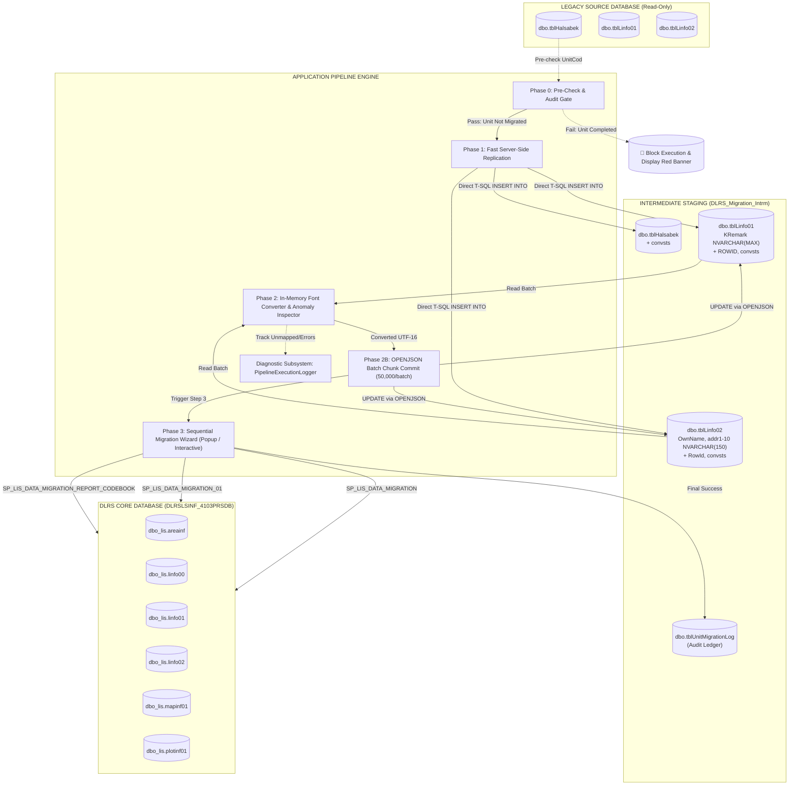

# DLRS Land Record Data Migration System — Operational Flow & Technical Manual

**Document Version:** 1.0  
**Application Release:** `v0.14`  
**Target Platform:** .NET 10.0 WPF (x64) | Microsoft SQL Server 2016+ (Compatibility Level ≥ 130)  
**Primary Target Database:** `DLRSLSINF_4103PRSDB`  
**Intermediate Staging Database:** `DLRS_Migration_Intrm`  

---

## Table of Contents

1. [Executive Summary & Architectural Philosophy](#1-executive-summary--architectural-philosophy)
2. [End-to-End System Architecture & Data Topology](#2-end-to-end-system-architecture--data-topology)
3. [Pre-Flight Preparation & Security Controls (Step 0)](#3-pre-flight-preparation--security-controls-step-0)
4. [Step 1: Data Replication & Staging (Extract & Stage)](#4-step-1-data-replication--staging-extract--stage)
5. [Step 2: Real-Time Unicode Conversion & Database Sync (Transform)](#5-step-2-real-time-unicode-conversion--database-sync-transform)
6. [Step 3: Sequential Core Migration Pipeline (Load to Core DB)](#6-step-3-sequential-core-migration-pipeline-load-to-core-db)
7. [Step 4: Audit Verification & Migrated Units Summary (Verify & Audit)](#7-step-4-audit-verification--migrated-units-summary-verify--audit)
8. [Diagnostic Subsystems, Logging & Failure Recovery](#8-diagnostic-subsystems-logging--failure-recovery)
9. [Central Configuration Reference (`AppConfig.cs`)](#9-central-configuration-reference-appconfigcs)
10. [Operator Troubleshooting & Practical Scenarios](#10-operator-troubleshooting--practical-scenarios)

---

## 1. Executive Summary & Architectural Philosophy

The **DLRS Land Record Data Migration System** is an enterprise-grade desktop migration suite engineered to transition legacy Land Information System (PRS / LIS) databases into the modernized DLRS Core Land Database schema (`DLRSLSINF_4103PRSDB`).

### Core Architectural Guarantees

1. **Strict Legacy Read-Only Isolation:**  
   Legacy source databases are treated as immutable legal records. The tool **never alters, writes to, adds columns to, or modifies data types within the source database**. No schema modification (`ALTER TABLE`, `ADD COLUMN`) touches legacy source databases.
2. **Intermediate Staging (`DLRS_Migration_Intrm`):**  
   All schema adaptations (widening text columns to `NVARCHAR(MAX)`, adding tracking indicators `convsts`, and synthesizing deterministic `ROWID` surrogate keys) take place in an isolated, high-performance intermediate database on the same SQL Server instance.
3. **True Real-Time Adarshalipi-to-Unicode Conversion:**  
   Custom in-memory conversion transforms legacy ANSI character sets into standard UTF-16 Bengali Unicode at speeds exceeding 10,000+ records per second, backed by automatic anomaly detection and duplicate-conversion guards (preventing Mojibake).
4. **Resilient Sequential Stored Procedure Pipeline:**  
   Stored procedures execute in a strictly defined, centrally configured sequence. If a specific business step or ProcID has been commented out in SQL Server, the pipeline detects the omission and safely bypasses it without crashing or corrupting dependent records.
5. **Audited Unit Integrity:**  
   Every migrated Mouza/Unit is tracked in an audit ledger (`tblUnitMigrationLog`). Re-migration of already-completed units is blocked at the gate to prevent duplicate plots or overlapping ownership shares.

---

## 2. End-to-End System Architecture & Data Topology



---

## 3. Pre-Flight Preparation & Security Controls (Step 0)

### 3.1 Server Connection & Authentication
- The operator selects the SQL Server instance (or types a custom host / port).
- **Authentication Modes:**
  - **Windows Authentication:** Integrated security using current Windows domain / local credentials.
  - **SQL Server Authentication:** Explicit credentials (`sa` or migration user) with credential persistence options.
- Upon connecting, the system retrieves the catalog of databases matching DLRS naming conventions (`PRS_*`, `DLRS_*`, `*LSINF*`).

### 3.2 Role-Based Security Modes
- **Administrator Role:** Full access to all tools, force re-conversion options, manual procedure overrides, and database creation utilities.
- **Operator Role:** Streamlined 1-Click execution mode; destructive actions (such as re-converting already-converted Unicode text) are strictly locked to protect data integrity.

### 3.3 Intermediate Database Setup & Validation
The application validates the existence and health of `DLRS_Migration_Intrm`:
- **Compatibility Level Verification:** Requires `compatibility_level >= 130` (SQL Server 2016+) to enable native `OPENJSON` array parsing. If an existing database has an older compatibility level, the system alerts the user and provides an automated upgrade path (`ALTER DATABASE [DLRS_Migration_Intrm] SET COMPATIBILITY_LEVEL = 130`).
- **Schema Validation:** Verifies the presence of required staging tables, primary keys, `NVARCHAR(MAX)` Unicode columns, `ROWID` integer surrogates, and tracking columns (`convsts`).
- **One-Click Generation:** If the intermediate database does not exist, the **[Create DB]** button automatically provisions the complete staging database with optimized indexes.

### 3.4 Unit Migration Audit Pre-Check (Duplicate Guard)
Before any data copying or processing begins, the system queries the audit ledger:
```sql
SELECT DISTINCT UnitCod, MigratedDate 
FROM [DLRS_Migration_Intrm].dbo.tblUnitMigrationLog 
WHERE UnitCod IN (SELECT DISTINCT UnitCod FROM [{sourceDbName}].dbo.tblHalsabek)
  AND Status = 'COMPLETED';
```
- **If Already Migrated:**
  - The tool immediately shows a bold red warning banner in the left panel:  
    `⚠️ Unit code(s) [201901] in database 'PRS_...' are ALREADY logged as COMPLETED in tblUnitMigrationLog. Migration cannot proceed to prevent duplicate records.`
  - The **[⚡ Start Conversion & Migration]** and **[Copy & Stage Data]** buttons are disabled.
  - Any attempt to force execution triggers a modal alert and halts processing, eliminating accidental re-insertion of duplicate records.

---

## 4. Step 1: Data Replication & Staging (Extract & Stage)

When the operator initiates Step 1 (or runs Auto Mode), the application extracts data from the legacy source and populates `DLRS_Migration_Intrm`.

### 4.1 Server-Side Set-Based Staging
Rather than pulling hundreds of thousands of rows across the network into client memory, the application executes optimized T-SQL server-side `INSERT INTO ... SELECT` statements directly inside the SQL Server instance.

```sql
-- 1. Stage tblHalsabek
TRUNCATE TABLE [DLRS_Migration_Intrm].dbo.tblHalsabek;
INSERT INTO [DLRS_Migration_Intrm].dbo.tblHalsabek (
    ComCod, UnitCod, KhtNum, SbkKht, PltNum, SbkPlt, PltTyp, Remarks, convsts
)
SELECT ComCod, UnitCod, KhtNum, SbkKht, PltNum, SbkPlt, PltTyp, Remarks, N''
FROM [PRS_SOURCE_DB].dbo.tblHalsabek;

-- 2. Stage tblLinfo01 with Synthesized ROWID
TRUNCATE TABLE [DLRS_Migration_Intrm].dbo.tblLinfo01;
INSERT INTO [DLRS_Migration_Intrm].dbo.tblLinfo01 (
    UnitCod, KhtNum, PltNum, KRemark, 
    eascom1, eascom2, eascom3, eascom4, eascom5, eascom6, 
    convsts, ROWID
)
SELECT 
    UnitCod, KhtNum, PltNum, 
    CAST(KRemark AS NVARCHAR(MAX)), 
    eascom1, eascom2, eascom3, eascom4, eascom5, eascom6, 
    N'', 
    ROW_NUMBER() OVER(ORDER BY (SELECT NULL)) AS ROWID
FROM [PRS_SOURCE_DB].dbo.tblLinfo01;

-- 3. Stage tblLinfo02 with Synthesized RowId
TRUNCATE TABLE [DLRS_Migration_Intrm].dbo.tblLinfo02;
INSERT INTO [DLRS_Migration_Intrm].dbo.tblLinfo02 (
    ComCod, UnitCod, KhtNum, OwnId, OwnName, 
    addr1, addr2, addr3, addr4, addr5, addr6, addr7, addr8, addr9, addr10, 
    convsts, RowId
)
SELECT 
    ComCod, UnitCod, KhtNum, OwnId, 
    CAST(OwnName AS NVARCHAR(150)), 
    CAST(addr1 AS NVARCHAR(150)), CAST(addr2 AS NVARCHAR(150)), 
    CAST(addr3 AS NVARCHAR(150)), CAST(addr4 AS NVARCHAR(150)), 
    CAST(addr5 AS NVARCHAR(150)), CAST(addr6 AS NVARCHAR(150)), 
    CAST(addr7 AS NVARCHAR(150)), CAST(addr8 AS NVARCHAR(150)), 
    CAST(addr9 AS NVARCHAR(150)), CAST(addr10 AS NVARCHAR(150)), 
    N'', 
    ROW_NUMBER() OVER(ORDER BY (SELECT NULL)) AS RowId
FROM [PRS_SOURCE_DB].dbo.tblLinfo02;
```

### 4.2 Key Technical Safeguards in Step 1
- **Surrogate Key Generation:** Legacy PRS databases often lack an identity primary key or have duplicate composite keys. Generating `ROW_NUMBER() OVER(ORDER BY (SELECT NULL))` ensures every staged row has a distinct, indexed integer ID (`ROWID` / `RowId`).
- **Unicode Column Widening:** `KRemark` is converted from legacy single-byte text to `NVARCHAR(MAX)` during staging, preventing character truncation when multibyte Unicode glyphs are written.
- **Source Isolation:** The source database is queried with standard `SELECT` operations. No locks are escalated and source schemas remain untouched.

---

## 5. Step 2: Real-Time Unicode Conversion & Database Sync (Transform)

Legacy land records store Bengali text using legacy 8-bit ANSI fonts (primarily Adarshalipi / Sutonny-style encoding). Step 2 transforms this text into UTF-16 Bengali Unicode and writes it back to `DLRS_Migration_Intrm`.

### 5.1 Adarshalipi-to-Unicode Mapping Engine
Conversion is performed using an in-memory lexical parser [`AdarshalipiToUnicodeConverter`](file:///e:/DLRS_DATA-MIGRATION/01.%20WPF/01.%20Main/FontConverter/AdarshalipiToUnicodeConverter.cs):
- **Yuktakshar (Conjuncts) Handling:** Re-sequences vowel signs (Kar) and reph/hasanta clusters that appear visually before consonants in ANSI fonts into correct Unicode logical character order.
- **Target Fields:**
  - `dbo.tblLinfo01`: `KRemark`, `eascom1`, `eascom2`, `eascom3`, `eascom4`, `eascom5`, `eascom6`
  - `dbo.tblLinfo02`: `OwnName`, `addr1`, `addr2`, `addr3`, `addr4`, `addr5`, `addr6`, `addr7`, `addr8`, `addr9`, `addr10`

### 5.2 Real-Time Value Mapping Anomaly Detection
Every converted string is passed through [`ConvertAndCheckMapping()`](file:///e:/DLRS_DATA-MIGRATION/01.%20WPF/01.%20Main/LandPressDataMigrationDesktopApp/MainWindow.xaml.cs#L192) and inspected by [`PipelineExecutionLogger`](file:///e:/DLRS_DATA-MIGRATION/01.%20WPF/01.%20Main/LandPressDataMigrationDesktopApp/PipelineExecutionLogger.cs):
1. **Fallback Glyph Marker (`'×'`):** Flags when the conversion dictionary encounters an unmapped character code.
2. **Empty String Output:** Flags if an input field contains text but conversion yields an empty or whitespace string.
3. **Non-Bengali High-ASCII Residue:** Flags byte codes that failed transformation into the Unicode Bengali block (`\u0980`–`\u09FF`).
4. **Audit Trail:** Anomaly details (Table, Column, Record ID / `RowId`, Raw ANSI string, and Converted Unicode) are logged and instantly viewable in the **Log View Screen**.

### 5.3 Anti-Mojibake Guard
Re-running font conversion over text that is already in Unicode causes severe corruption (turning characters into illegible Mojibake).
- The system samples loaded records using `ContainsBengaliUnicode()`.
- If Bengali Unicode is detected, **conversion is automatically bypassed** in Auto Mode, and **strictly blocked** for operators in Manual Mode.

### 5.4 High-Performance OPENJSON Batch Updating
After in-memory conversion, updates are committed to `DLRS_Migration_Intrm` using SQL Server's native `OPENJSON` parser in configurable chunk sizes (default: `50,000` records per batch):

```sql
UPDATE target
SET target.KRemark = src.KRemark,
    target.eascom1 = src.eascom1,
    target.convsts = 'SUCCESS'
FROM [DLRS_Migration_Intrm].dbo.tblLinfo01 target
INNER JOIN OPENJSON(@jsonBatch) WITH (
    rowid INT '$.rowid',
    KRemark NVARCHAR(MAX) '$.KRemark',
    eascom1 NVARCHAR(150) '$.eascom1'
) src ON target.ROWID = src.rowid;
```
- **Throughput:** Typically completes thousands of updates in under 2 seconds per batch.
- **Index Optimization:** Staging tables include dedicated indexes on `(ROWID)` and `(RowId)` to ensure all `JOIN` operations execute as constant-time index seeks.

---

## 6. Step 3: Sequential Core Migration Pipeline (Load to Core DB)

Once data in `DLRS_Migration_Intrm` is fully staged and converted to Unicode, Phase 3 executes the migration stored procedures into the destination Core Database (`DLRSLSINF_4103PRSDB`).

### 6.1 Modal Wizard Execution in Both Modes
- **In Automated Mode (Default):** The main window automatically launches the [`DataMigrationWizardWindow`](file:///e:/DLRS_DATA-MIGRATION/01.%20WPF/01.%20Main/LandPressDataMigrationDesktopApp/DataMigrationWizardWindow.xaml.cs) modal dialog with `autoStart: true`. The operator sees every step running live on screen, accompanied by step dots, SQL timers, and record output grids.
- **In Manual Mode:** The operator opens the wizard by clicking `[Step 3: Migration]`, executing steps one by one or clicking `[▶ Start Auto-Run]` at their own pace.

### 6.2 Master Sequential Pipeline Specification
All steps are centrally defined and managed in [`AppConfig.GetPipelineSteps()`](file:///e:/DLRS_DATA-MIGRATION/01.%20WPF/01.%20Main/LandPressDataMigrationDesktopApp/AppConfig.cs#L127):

| Order | ProcID | Stored Procedure | Title | Purpose & Description | Required? |
| :---: | :--- | :--- | :--- | :--- | :---: |
| **1** | `GETROWCOUNTS` | `SP_LIS_DATA_MIGRATION_REPORT_CODEBOOK` | Pre-Check Audit | Queries total record counts from `tblLinfo01` and `tblLinfo02` in staging. | Optional |
| **2** | `MTO_AREAINF` | `SP_LIS_DATA_MIGRATION` | Prepare Area Information | Imports Mouza and boundary definitions from staging into `dbo_lis.areainf`. | Optional |
| **3** | `MANAGE_MISSMATCH` | `SP_LIS_DATA_MIGRATION` | Verify Khatians & Mismatches | Compares `tblLinfo01`, `tblLinfo02`, and `tblHalsabek` to detect and list mismatching records. | Optional |
| **4** | `MTO_LINFO00` | `SP_LIS_DATA_MIGRATION` | Import Khatian Masters | Migrates Khatian master records into `dbo_lis.linfo00` and flags `convsts = 'SUCCESS'`. | **Required** |
| **5** | `MTO_LINFO01` | `SP_LIS_DATA_MIGRATION` | Import Plot Details | Aggregates Halsabek plots, merges areas from `tblLinfo01`, and inserts into `dbo_lis.linfo01`. | **Required** |
| **6** | `MTO_LINFO02` | `SP_LIS_DATA_MIGRATION` | Import Ownership & Demographics | Extracts owner relations, father/husband names from addresses, and writes to `dbo_lis.linfo02`. | **Required** |
| **7** | `UPDTMAPINF01` | `SP_LIS_DATA_MIGRATION` | Update Map Unit Codes | Inserts distinct unit codes from `tblHalsabek` into `dbo_lis.mapinf01` for sheet `'000'`. | Optional |
| **8** | `MTO_PLOTINF01` | `SP_LIS_DATA_MIGRATION` | Import Detailed Plot Attributes | Migrates distinct plot records into `dbo_lis.plotinf01`. | Optional |
| **9** | `MTO_LINFUSR` | `SP_LIS_DATA_MIGRATION_01` | User Staging (Optional) | Staging step for land info user credentials. | Optional (Disabled) |
| **10** | `MTO_LRSINF01` | `SP_LIS_DATA_MIGRATION_01` | RS Survey Header (Optional) | RS survey staging header. | Optional (Disabled) |
| **11** | `MTO_LRSINF02` | `SP_LIS_DATA_MIGRATION_01` | RS Survey Details (Optional) | RS survey staging details. | Optional (Disabled) |

### 6.3 Intelligent Commented-Out DB Failsafe
In real-world DLRS deployments, database administrators frequently comment out specific ProcID branches or stored procedures directly in SQL Server scripts.
- **The Problem:** In conventional migration scripts, a commented-out branch returns `Process ID "..." not found to execute` or SQL Error 2812 (`Could not find stored procedure`), terminating the application.
- **The Solution:** The pipeline routes all SQL exceptions through [`AppConfig.IsCommentedOutOrNotFoundInDb()`](file:///e:/DLRS_DATA-MIGRATION/01.%20WPF/01.%20Main/LandPressDataMigrationDesktopApp/AppConfig.cs#L113).
- **Behavior:**
  - Traps the SQL notice safely.
  - Marks the step with an informative status:  
    `ℹ Notice: Bypassed — Branch '...' was commented out or omitted in the database. Safely continued.`
  - The step indicator turns orange (bypassed).
  - The pipeline automatically proceeds to the next sequential step without breaking or crashing!

---

## 7. Step 4: Audit Verification & Migrated Units Summary (Verify & Audit)

### 7.1 Recording Audit Completion
When all required migration steps succeed, the application logs the transaction:
```sql
MERGE [DLRS_Migration_Intrm].dbo.tblUnitMigrationLog AS target
USING (SELECT @unitCod AS UnitCod, @sourceDb AS SourceDbName) AS src
ON (target.UnitCod = src.UnitCod)
WHEN MATCHED THEN 
    UPDATE SET Status = 'COMPLETED', MigratedDate = GETDATE(), SourceDbName = src.SourceDbName
WHEN NOT MATCHED THEN 
    INSERT (UnitCod, SourceDbName, MigratedDate, Status) 
    VALUES (src.UnitCod, src.SourceDbName, GETDATE(), 'COMPLETED');
```

### 7.2 Migrated Units Summary Dialog
Upon pipeline completion, the [`MigratedUnitsSummaryDialog`](file:///e:/DLRS_DATA-MIGRATION/01.%20WPF/01.%20Main/LandPressDataMigrationDesktopApp/MigratedUnitsSummaryDialog.xaml.cs) window opens:
- Summarizes the migrated Mouza names and `UnitCod` values.
- Shows total migrated counts:
  - **Total Khatians** migrated to `dbo_lis.linfo00`
  - **Total Plots** migrated to `dbo_lis.linfo01`
  - **Total Owners** migrated to `dbo_lis.linfo02`
- Verifies that zero orphan records were generated.

---

## 8. Diagnostic Subsystems, Logging & Failure Recovery

```
┌─────────────────────────────────────────────────────────────────────────────┐
│                       DLRS PIPELINE DIAGNOSTIC SUITE                        │
├────────────────────────────────┬────────────────────────────────────────────┤
│ PipelineExecutionLogger        │ Centralized in-memory ring-buffer logger   │
│ PipelineLogViewerWindow        │ Multi-criteria filterable DataGrid viewer  │
│ PipelineAlertWindow            │ User-guided error recovery dialog          │
│ Safe Application Exit Handler  │ Anti-corruption transaction rollback guard │
└────────────────────────────────┴────────────────────────────────────────────┘
```

### 8.1 Pipeline Log Viewer (`[📋 Logs]` in Top App Bar)
Accessible at any time via the top app bar or by pressing `Ctrl + L`:
- **Summary Metrics Bar:** Real-time counters showing Total entries, ❌ Errors, ⚠️ Warnings, and ℹ Info notices.
- **Search & Filters:**
  - Real-time text search across all message fields, table names, columns, and IDs.
  - **Severity Filter:** All Logs, Errors Only, Warnings & Errors, Info Only.
  - **Phase Filter:** Pre-Check, Step 1 (Staging), Step 2 (Font Conversion), Step 3 (Migration SP).
- **DataGrid Fields:**
  - Severity Icon & Color
  - Timestamp (`HH:mm:ss`)
  - Execution Phase
  - Table & Column
  - Record ID (`ROWID` or `UnitCod:KhtNum`)
  - Raw Value (Original ANSI)
  - Converted Value (Unicode UTF-16)
  - Detailed Description / Exception Message
- **Exporting:** One-click **[📥 Export to CSV]** exports all filtered or unfiltered records to a timestamped CSV spreadsheet for team handoff.

### 8.2 Interactive Pipeline Alert Window (`PipelineAlertWindow`)
When an unexpected SQL exception occurs (such as table lock timeout or missing column):
- Replaces generic modal message boxes with a styled, informative dialog.
- Displays the operational step name, human-readable summary, and full SQL exception details.
- **Options Provided:**
  - **[🔄 Retry Step]:** Re-executes the failed step immediately.
  - **[⏭ Skip Step]:** Bypasses the step (available on non-required steps).
  - **[⏹ Abort Pipeline]:** Cleanly cancels the pipeline, releases locks, and returns to the main interface.

### 8.3 Safe Window Closing & Anti-Corruption Guard
If an operator closes the desktop app or wizard during an active migration:
- The closing event is intercepted by `MainWindow_Closing`.
- The application prompts:  
  `⚠️ An operation is currently running: Step X. Closing the application now may cause incomplete data transfer. Are you sure you want to cancel and exit?`
- If confirmed, the active `CancellationTokenSource` signals immediate cancellation to all threads, SQL connections are safely closed, and uncommitted transactions roll back cleanly.

---

## 9. Central Configuration Reference (`AppConfig.cs`)

All system timers, batch chunk sizes, procedure orderings, and behavior switches are maintained in a single file: [`LandPressDataMigrationDesktopApp\AppConfig.cs`](file:///e:/DLRS_DATA-MIGRATION/01.%20WPF/01.%20Main/LandPressDataMigrationDesktopApp/AppConfig.cs).

| Configuration Property | Type | Default | Description & Operational Impact |
| :--- | :---: | :---: | :--- |
| `Version` | `string` | `"v0.14"` | Global application version. Automatically propagates to all window headers, app bars, and dialogs. |
| `IntermediateDbName` | `string` | `"DLRS_Migration_Intrm"` | Name of the staging database required on the connected SQL Server instance. |
| `ConversionRowDelayMs` | `int` | `0` | Artificial delay per record during font conversion (in milliseconds). Default `0` enables true real-time maximum conversion speed (~10,000+ rec/s). |
| `ConversionUiUpdateIntervalMs` | `int` | `50` | UI refresh throttle in milliseconds (50 ms = 20 FPS). Prevents WPF UI message dispatch starvation on large datasets. |
| `BatchChunkSize` | `int` | `50_000` | Number of records serialized into each JSON payload chunk during Step 2 database updates. |
| `BatchUpdateDelayMs` | `int` | `0` | Delay between consecutive SQL JSON updates. Leave at `0` for fast SSDs; increase to `50`–`100` ms on shared or slow servers to yield disk I/O. |
| `DefaultAutoExecuteAll` | `bool` | `true` | Default execution mode for Step 3. When `true`, the wizard runs all steps automatically; when `false`, it waits for manual step execution. |
| `ContinueIfStepCommentedOutInDb` | `bool` | `true` | When `true`, steps whose stored procedures or ProcID branches are commented out in SQL Server are safely bypassed rather than throwing errors. |
| `AutoRunStepDelayMs` | `int` | `300` | Pause in milliseconds between consecutive steps during automated execution to allow visual step transition. |

---

## 10. Operator Troubleshooting & Practical Scenarios

### Scenario A: A specific ProcID branch has been commented out in SQL Server
- **Symptom:** Step 3 executes, and Step 4 (`MTO_LINFO00`) shows an orange alert icon with status: `ℹ Notice: Bypassed — Branch 'MTO_LINFO00' was commented out or omitted in the database. Safely continued.`
- **Explanation:** The system detected that the DBA commented out this branch in `dbo.SP_LIS_DATA_MIGRATION`.
- **Action Required:** None. The pipeline safely logged the notice and continued with remaining steps. If you wish to execute this step, uncomment it in the SQL Server stored procedure and re-run that individual step in the wizard.

### Scenario B: Unit Code is blocked with red alert banner
- **Symptom:** Selecting source database `PRS_RAJSHAHI_01` shows red banner: `⚠️ Unit code(s) [201901] in database 'PRS_RAJSHAHI_01' are ALREADY logged as COMPLETED in tblUnitMigrationLog.`
- **Explanation:** This unit was previously migrated into `DLRSLSINF_4103PRSDB`. The system blocks re-migration to prevent overwriting or duplicating plots.
- **Action Required:** If you genuinely need to re-migrate this unit, an administrator must delete the unit log entry from `[DLRS_Migration_Intrm].dbo.tblUnitMigrationLog` or clear target records in `DLRSLSINF_4103PRSDB` before re-running.

### Scenario C: Character mapping anomalies detected during font conversion
- **Symptom:** Step 2 status text indicates: `⚠️ Converted with 4 character mapping notice(s). Click [📋 Logs] in the top bar to inspect.`
- **Explanation:** Unmapped ANSI glyphs or fallback `'×'` markers were found in one or more records.
- **Action Required:**
  1. Click **[📋 Logs]** in the top navigation bar.
  2. Filter by `Severity: Warnings & Errors` and `Phase: Step 2`.
  3. Inspect the `RecordId`, `RawValue`, and `ConvertedValue` to see the exact text.
  4. Click **[📥 Export to CSV]** to save the anomaly report for data review.

### Scenario D: Step 3 Wizard closed prematurely in Auto Mode
- **Symptom:** The main window displays: `⚠️ Migration wizard was closed before completing all required steps.`
- **Explanation:** The operator closed the wizard modal dialog before all required stored procedures completed execution.
- **Action Required:** Click **[Step 3: Migration]** in the top stepper to re-open the wizard, review completed steps, and click **[▶ Resume Auto-Run]** or execute remaining steps manually.
