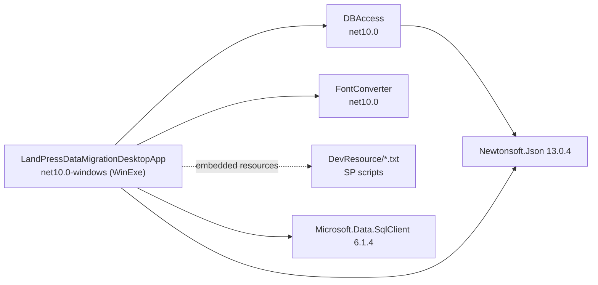
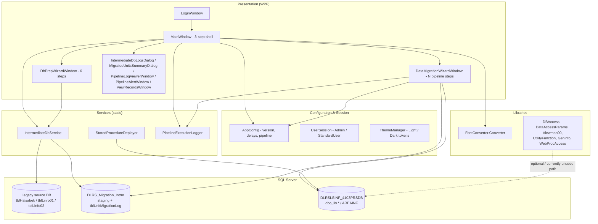

# DLRS Data Migration Tool — Project Documentation

> **Document scope:** complete technical documentation of the solution in this repository (architecture, modules, classes, database objects, configuration, workflows, build/deploy and known limitations).
> **Verified against:** the actual source of this working copy (branch `main`, commit `0b836be`). At scan time the working tree also contained two uncommitted local edits (`MainWindow.xaml`, `MainWindow.xaml.cs` — the "Throttle Delay" checkbox behaviour), which are included in this description.
> **Documentation date:** 2026-10-31

| Item | Value |
|---|---|
| Product name | `DLRS Data Migration Tool` (`AppConfig.AppName`) |
| Application version | `v0.19a` (`AppConfig.Version`) |
| Solution file | `LandPressDataMigrationDesktopApp.slnx` |
| Projects | 3 (`DBAccess`, `FontConverter`, `LandPressDataMigrationDesktopApp`) |
| Target frameworks | `net10.0-windows` (WPF app, WinExe), `net10.0` (two class libraries) |
| UI technology | WPF (XAML) + WinForms interop (`UseWindowsForms=true`, used for `OpenFileDialog`/`SaveFileDialog`) |
| Data access | `Microsoft.Data.SqlClient` 6.1.4 (ADO.NET, raw SQL + stored procedures) |
| Serialization | `Newtonsoft.Json` 13.0.4 |
| Build status (verified) | `dotnet build LandPressDataMigrationDesktopApp.slnx` → **Build succeeded, 0 errors, 8 warnings** |

---

## Table of contents

1. [Purpose and scope](#1-purpose-and-scope)
2. [Solution and project structure](#2-solution-and-project-structure)
3. [Technology stack and prerequisites](#3-technology-stack-and-prerequisites)
4. [Runtime architecture](#4-runtime-architecture)
5. [End-to-end workflow](#5-end-to-end-workflow)
6. [Class and file reference](#6-class-and-file-reference)
7. [Database objects](#7-database-objects)
8. [Configuration reference (`AppConfig`)](#8-configuration-reference-appconfig)
9. [Font conversion subsystem](#9-font-conversion-subsystem)
10. [Logging and diagnostics](#10-logging-and-diagnostics)
11. [UI, theming and typography](#11-ui-theming-and-typography)
12. [Safety, security and integrity controls](#12-safety-security-and-integrity-controls)
13. [Build, run and deploy](#13-build-run-and-deploy)
14. [Extension guide](#14-extension-guide)
15. [Known limitations and observations](#15-known-limitations-and-observations)
16. [Existing documentation index](#16-existing-documentation-index)

---

## 1. Purpose and scope

The **DLRS Data Migration Tool** is a Windows desktop application used to migrate legacy **Land Information System (PRS/LIS)** databases — originally digitised with **Adarshalipi** (legacy ANSI/Bangla) fonts — into the province-level core land database **`DLRSLSINF_4103PRSDB`**, storing text as **Bengali Unicode (UTF-16)**.

The tool performs four responsibilities, always in this order:

| # | Responsibility | Where implemented |
|---|---|---|
| 1 | **Stage** legacy tables from a read-only source DB into an isolated staging DB `DLRS_Migration_Intrm` (widening columns to `NVARCHAR`, adding `convsts` flags and surrogate `RowId`) | `IntermediateDbService.StageDataFromSourceAsync` |
| 2 | **Convert** legacy Adarshalipi text to Unicode in memory, then write the converted text back to the staging DB in JSON batch chunks | `FontConverter.Converter`, `MainWindow.CommitUnicodeUpdate*` |
| 3 | **Migrate** staged data into the core DB by executing a centrally configured, sequential series of stored-procedure "ProcID" steps | `DataMigrationWizardWindow`, `AppConfig.GetPipelineSteps()` |
| 4 | **Audit** every migrated Mouza/Unit in `tblUnitMigrationLog`, block re-migration, and report migrated unit totals | `IntermediateDbService.LogCompletedUnitsAsync`, `MigratedUnitsSummaryDialog` |

Design invariants (verified in code):

* **The migration pipeline does not modify the legacy source database.** Every `ALTER TABLE` / `CREATE TABLE` executed by the staging service targets `DLRS_Migration_Intrm`. The only component that alters the *selected source DB* is the operator-driven **Database Preparation Wizard** (`DbPrepWizardWindow`, steps 2–6) — an intentional, explicit exception behind a 6-step flow.
* **Schema adaptation happens in the staging DB** (`tblLinfo01.KRemark` → `NVARCHAR(MAX)`, `tblLinfo02.addr1..addr10` → `NVARCHAR(150)`, `convsts` columns, sequential `RowId`).
* **Stored procedures are the migration engine.** The C# client orchestrates order, parameters and error handling; the only business logic implemented in C# is text conversion plus pre/post verification.

---

## 2. Solution and project structure

```
01. Main/                                    ← repository root (git: onmoaw/DLRS-Migration)
├── LandPressDataMigrationDesktopApp.slnx    ← solution (XML "slnx", all projects → Release)
├── .gitignore
├── README.md                                ← short note + sample AREAINF migration query
├── DLRS_DATA_MIGRATION_SYSTEM_OPERATION_MANUAL.md   ← operator/technical manual (v1.0, app v0.14)
├── PROJECT_DOCUMENTATION.md                 ← THIS document
│
├── DBAccess/                                ← class library (net10.0) — data-access helpers & entities
│   ├── DataAccessParams.cs                  (67 lines)
│   ├── DataMigrationEntityView00.cs         (56 lines)
│   ├── DataMigrationViewman00.cs            (47 lines)
│   ├── Geninfo.cs                           (61 lines)
│   ├── UtilityFunction.cs                   (1,189 lines)
│   └── WebProcAccess.cs                     (70 lines)
│
├── FontConverter/                           ← class library (net10.0) — Adarshalipi → Unicode
│   └── AdarshalipiToUnicodeConverter.cs     (220 lines)
│
├── DevResource/                             ← non-compiled source assets
│   ├── SP_LIS_DATA_MIGRATION v2.txt                  (74 KB — embedded as Scripts\SP_LIS_DATA_MIGRATION.sql)
│   ├── SP_LIS_DATA_MIGRATION_01 v1.txt               (12 KB — embedded)
│   ├── SP_LIS_DATA_MIGRATION_REPORT_CODEBOOK v1.txt  ( 9 KB — embedded)
│   ├── CheckandChangeDbCompatibilityLevelsqlNew.sql  (85 lines)
│   ├── DBdetails v1.sql                              (2,230 lines — schema reference)
│   ├── DBdetails v2.sql                              (7,079 lines — schema reference)
│   └── DLRS_Full_System_Walkthrough.md               (1,190 lines — narrative walkthrough)
│
└── LandPressDataMigrationDesktopApp/        ← WPF application (net10.0-windows, WinExe)
    ├── App.xaml / App.xaml.cs                ← global resources, typography, theme bootstrap
    ├── AssemblyInfo.cs
    ├── Assets/  (app.ico, "DLRS-Migration App Icon.png")
    ├── LoginWindow.xaml(.cs)                 ← login + role selection
    ├── MainWindow.xaml(.cs)                  ← main 3-step workflow shell (~3,390 lines code-behind)
    ├── DbPrepWizardWindow.xaml(.cs)          ← 6-step source-DB preparation wizard
    ├── DataMigrationWizardWindow.xaml(.cs)   ← sequential SP pipeline wizard (Step 3)
    ├── IntermediateDbLogsDialog.xaml(.cs)    ← audit log viewer (tblUnitMigrationLog)
    ├── MigratedUnitsSummaryDialog.xaml(.cs)  ← migrated unit/khatian/plot/owner report
    ├── PipelineLogViewerWindow.xaml(.cs)     ← structured log viewer (filter/search/export CSV)
    ├── PipelineAlertWindow.xaml(.cs)         ← blocking error dialog with Retry/Abort
    ├── ViewRecordsWindow.xaml(.cs)           ← land-record search prototype (dummy data)
    ├── AppConfig.cs                          ← central configuration + pipeline definition
    ├── IntermediateDbService.cs              ← staging DB lifecycle, DDL, staging, audit log
    ├── StoredProcedureDeployer.cs            ← deploys the 3 SP scripts from embedded resources
    ├── PipelineExecutionLogger.cs            ← in-memory + file + CSV logging
    ├── ThemeManager.cs                       ← Light/Dark theme token manager
    └── UserSession.cs                        ← current user + role (Admin / StandardUser)
```

### Project dependency graph



---

## 3. Technology stack and prerequisites

| Layer | Technology / package | Version / notes |
|---|---|---|
| Runtime | .NET | `net10.0-windows` (app), `net10.0` (libraries); `UseWPF=true`, `UseWindowsForms=True`, `Nullable=enable`, `ImplicitUsings=enable` |
| UI | WPF / XAML | "Code-behind" style (no MVVM framework); theme applied through `DynamicResource` brushes; step chips built in C# |
| DB driver | `Microsoft.Data.SqlClient` | 6.1.4 (note: **not** the legacy `System.Data.SqlClient`) |
| JSON | `Newtonsoft.Json` | 13.0.4 (`JsonConvert`, `PostAsJsonAsync`) |
| SQL Server | SQL Server 2016+ | `compatibility_level >= 130` required (JSON support). Staging DB set to 150, fallback 130 |
| IDE / SDK | Visual Studio 2022+ (`.slnx` support) or `dotnet` CLI 10.x | |
| OS | Windows 10/11 x64 | |

**Required server-side objects**

| Object | Database | Purpose |
|---|---|---|
| `DLRS_Migration_Intrm` (database) | same SQL instance as the source | Permanent staging + audit database; created/repaired by the app |
| `dbo.SP_LIS_DATA_MIGRATION` | `DLRSLSINF_4103PRSDB` | Main migration SP (ProcID dispatcher) |
| `dbo.SP_LIS_DATA_MIGRATION_01` | `DLRSLSINF_4103PRSDB` | Secondary staging SP (optional steps 9–11) |
| `dbo.SP_LIS_DATA_MIGRATION_REPORT_CODEBOOK` | `DLRSLSINF_4103PRSDB` | Helper SP (`SLCTLINFO01`, `SLCTLINFO02`, `UPDTTBLINF01`, `UPDTTBLINF02`, `GETROWCOUNTS`) |

The three scripts are **embedded resources** in the app assembly and are auto-deployed by `StoredProcedureDeployer` when missing.

---

## 4. Runtime architecture



**Composition style:** no DI container. All services are `static` classes; windows receive connection strings through constructors (e.g. `new DataMigrationWizardWindow(targetCs, AppConfig.IntermediateDbName, autoStart: true)`), while `UserSession`, `ThemeManager` and `PipelineExecutionLogger` are global statics.

**Concurrency model**

* Database work runs inside `Task.Run` / `async` methods; UI updates are marshalled with `Dispatcher.Invoke`.
* A single `CancellationTokenSource` (`MainWindow._currentOperationCts`) is created per long operation and drives Pause/Stop buttons.
* Progress UI is throttled: `AppConfig.ConversionUiUpdateIntervalMs` (50 ms) for conversion progress, `DispatcherTimer` (1 s) for elapsed-time labels.
* `PipelineExecutionLogger` is thread-safe (`lock`) and appends each entry to `Logs\Pipeline_yyyyMMdd.log`.

**Connection strings** (`MainWindow.BuildConnectionString`)

```
Windows auth : Server=<server>;Database=<db>;Integrated Security=True;Encrypt=True;TrustServerCertificate=True;
SQL auth     : Server=<server>;Database=<db>;User Id=<user>;Password=<pwd>;Encrypt=True;TrustServerCertificate=True;
```

`_baseConnectionString` is built against `master` and used for cross-database operations; per-purpose strings are created for the source DB, the staging DB (`AppConfig.IntermediateDbName`) and the core DB (`DLRSLSINF_4103PRSDB`, field `_BaseDbName`).

---

## 5. End-to-end workflow

### 5.1 Startup and login

| Step | Implementation |
|---|---|
| App boot | `App.OnStartup` → `ThemeManager.ApplyTheme(AppTheme.Light)`, then `StartupUri="LoginWindow.xaml"` |
| Credentials | Hard-coded in `LoginWindow`: `Admin / Admin#321` → `UserRole.Admin`; `User / 1234` → `UserRole.StandardUser` |
| Session | `UserSession.SetUser(name, role)`; `UserSession.IsAdmin` drives UI wording and privilege checks |
| Transition | `new MainWindow()` replaces `Application.Current.MainWindow`, then `LoginWindow` closes |

### 5.2 Main window layout (`MainWindow.xaml`)

```
┌ TOP APP BAR ─────────────────────────────────────────────────────────────┐
│ brand • role badge • [⚡ Auto/Manual mode] • [📋 Logs] • [🔎 View Records] │
│ • [☀️/🌙 Theme]                                                          │
├ LEFT COLUMN (450 px) ─────────────┬ RIGHT COLUMN (3 sequential panels) ───┤
│ PREPARATION card                  │ panelStep1CopyToIntrm   (blue)        │
│  • Server + auth + Connect        │ panelStep2FontConvert   (green)       │
│  • Intermediate DB guard card     │ panelStep3Migration     (purple)      │
│    (Create/Repair, View Logs)     │                                       │
│  • Source DB list                 │ Only the *current* step panel is      │
│  • Pre-Step: Restore / Attach .bak│ visible (`UpdateWorkflowState()`).    │
│  • Prepared-DB actions            │                                       │
├ FOOTER ──────────────────────────────────────────────────────────────────┤
```

Key state fields in `MainWindow`:

| Field | Meaning |
|---|---|
| `_isIntermediateDbReady` | Staging DB exists **and** passed deep schema validation |
| `_isStage2Completed` | Step 1 (copy & stage) done |
| `_isStage3Completed` | Step 2 (Unicode conversion + write-back) done |
| `_isStage4Completed` | Step 3 (core migration) done |
| `_currentActiveStep` | `1..3` — which right-hand panel is visible |
| `_isManualModeEnabled`, `_isAutoPipelinePaused` | Auto (1-click) vs manual mode, pause state |
| `_isOperationRunning`, `_currentOperationCts` | Failsafe re-entrancy guard + cancellation |

### 5.3 Stage 0 — Connection, staging-DB guard and pre-flight

| Action | Code | Behaviour |
|---|---|---|
| Connect | `BtnConnect_Click` → `LoadDatabases` | Opens `master`, lists `sys.databases` with `state_desc='ONLINE'` excluding `master/tempdb/model/msdb/DLRS_Migration_Intrm` |
| Staging DB guard | `CheckAndValidateIntermediateDbAsync` | 1) DB exists? 2) `IntermediateDbService.ValidateSchemaAsync` (compat ≥ 130, 4 tables, `NVARCHAR` types, `RowId`, `convsts`, `KRemark` = `NVARCHAR`) 3) Ready → enables the DB list |
| Missing / invalid staging DB | `BtnCreateOrRepairIntrmDb_Click` | `CreateOrRepairDatabaseAsync` (CREATE DATABASE → compat 150/130 → `CREATE TABLE IF NOT EXISTS` DDL for `tblHalsabek`, `tblLinfo01`, `tblLinfo02`, `tblUnitMigrationLog` + index), then re-validate |
| Restore / Attach | `RunPreStep` → `RunRestoreAsync` / `RunAttachAsync` | Discovers default data/log folders via `SERVERPROPERTY`, registry (`xp_instance_regread`) or `sys.master_files`; builds `RESTORE DATABASE … WITH MOVE … STATS = 10, REPLACE`; progress via `InfoMessage`. Attach supports `FOR ATTACH` / `FOR ATTACH_REBUILD_LOG`. Both use a 600 s timeout |
| Source DB readiness | `CheckDatabasePreparedAsync` | Verifies compat ≥ 130, `tblLinfo02.RowId`, `convsts` on all three tables, `tblLinfo01.KRemark` is `NVARCHAR` (`system_type_id = 231`) |
| DB preparation wizard | `DbPrepWizardWindow` (6 steps) | 1) inspect all DB compatibility levels 2) `ALTER DATABASE … SET COMPATIBILITY_LEVEL` 3) add + populate `tblLinfo02.RowId` 4) `tblLinfo01.KRemark → NVARCHAR(MAX)` 5) `tblLinfo02.OwnName/addr1..addr10 → NVARCHAR(150)` 6) add `convsts` to the three tables. Each step locks after success (`IsPreparationCompleted` = step 6 done) |

### 5.4 Step 1 — Copy & stage (`IntermediateDbService.StageDataFromSourceAsync`)

Server-side `INSERT … SELECT` (no client row streaming):

1. `TRUNCATE` staging tables (`tblHalsabek`, `tblLinfo01`, `tblLinfo02`) — staging always holds exactly one source DB.
2. Copy the three tables from `[<sourceDb>].[dbo]` with `CAST`/`CONVERT` to `NVARCHAR`, initialising `convsts = ''`.
3. Compute deterministic `RowId` for `tblLinfo02` (`ROW_NUMBER() OVER (ORDER BY …)`), matching the surrogate used by batch updates.
4. Returns `(HalsabekCount, Linfo01Count, Linfo02Count)`; the UI shows row counts and unlocks Step 2.

### 5.5 Step 2 — Unicode conversion & write-back

Manual mode (`fontConverterBTN_On_Click`) and auto mode (`ConvertFontForAutoAsync`) share the same logic:

1. Guard rails: Step 1 complete; Step 2 not already complete (**failsafe lock**); records loaded.
2. **Mojibake guard** — if loaded records (`KRemark`, `OwnName`, `addr1`) already contain Bengali Unicode (U+0980–U+09FF via `ContainsBengaliUnicode`), Standard users are blocked; Admin gets a confirmation prompt ("DANGER — ALREADY CONVERTED DATA DETECTED").
3. `tblLinfo01.KRemark` and `tblLinfo02.OwnName + addr1..addr10` are converted per record through `FontConverter.Converter.ConvertToAdarshalipi`, with per-field anomaly logging (`ConvertAndCheckMapping` → `PipelineExecutionLogger.CheckAndLogMappingAnomaly`).
4. Progress: percentage, record count, records/second, ETA — refreshed every `ConversionUiUpdateIntervalMs`.
5. Write-back in JSON chunks: `UpdateTblLinfo01InBatchesAsync` / `UpdateTblLinfo02InBatchesAsync` serialise `AppConfig.BatchChunkSize` records with `UtilityFunction.ListToJsonString(list, "tbl_tblLinfo01")` and call `SP_LIS_DATA_MIGRATION_REPORT_CODEBOOK` with `@ProcID = UPDTTBLINF01` / `UPDTTBLINF02`, `@Desc01 = DLRS_Migration_Intrm`, `@Djson1 = <json>`.
6. On completion `_isStage3Completed = true` and the "Update database" button is enabled/locked accordingly.

### 5.6 Step 3 — Sequential core migration (`DataMigrationWizardWindow`)

* Steps come **only** from `AppConfig.GetPipelineSteps()`; the wizard builds its step list, indicator chips and navigation from that array.
* Each step calls its SP with a fixed parameter contract:

```csharp
cmd.Parameters.Add(new SqlParameter("@ComCod", NVarChar, 2500) { Value = "4103" });
cmd.Parameters.Add(new SqlParameter("@ProcID", NVarChar, 2500) { Value = cfg.ProcId });
cmd.Parameters.Add(new SqlParameter("@Desc01", NVarChar, 2500) { Value = _sourceDbName });  // staging DB name
if (cfg.RequiresRsNumber)
    cmd.Parameters.Add(new SqlParameter("@Desc02", NVarChar, 2500) { Value = rsNum });      // default "201901"
```

* Execution mode: **Auto-Run** (`BtnStartAuto_Click`, with pause/resume/stop) or **manual** step-by-step (`BtnExecuteStep_Click`).
* The SP result is filled into a `DataSet` through `SqlDataAdapter`. If the first table contains an `ErrMsg` column, the message is classified:
  * matches `AppConfig.IsCommentedOutOrNotFoundInDb` → the step is marked **Bypassed** (warning) and the pipeline continues — the "commented-out branch" failsafe;
  * otherwise → error state; `PipelineAlertWindow` offers Retry/Abort.
* Steps with `HasResultTable = true` render the returned `DataTable` in the results grid.
* On completion: `IsMigrationCompleted = true`, the `MigrationCompleted` event fires, and `GetExecutionSummary()` (Executed/Bypassed/Skipped ProcIDs, ≤ 490 chars) is written to the audit log.
* Procedures are auto-deployed first: `StoredProcedureDeployer.EnsureProceduresDeployedAsync` checks `OBJECT_ID(...)` for the 3 SPs and runs the embedded scripts (`GO` split by `Regex`, `USE` batches skipped, 180 s timeout).

### 5.7 One-click auto pipeline (`MainWindow.RunCompleteAutoPipelineAsync`)

The "⚡ Auto" button chains all three stages with progress 2 → 30 → 35/45 → 60 → 75 → 80 → 100:

| Phase | Work | Progress |
|---|---|---|
| Pre-checks | server, source DB, staging DB ready, unit not already migrated | 2 % |
| 1/3 Staging | `StageDataFromSourceAsync`, `LoadIntermediateTablesAsync` | 30 % |
| 2/3 Convert | fetch staged rows → convert → commit JSON batches | 35–60 % |
| 3/3 Migrate | `EnsureProceduresDeployedAsync`, then modal `DataMigrationWizardWindow(autoStart: true)` | 80–100 % |
| Outcome | `LogCompletedUnitsAsync(..., "COMPLETED")` or `INCOMPLETE` / `CANCELLED` / `FAILED` | — |

Phase 1/2 failures raise `PipelineAlertWindow` with **Retry / Abort** (`allowSkip: false`) inside retry loops; cancelling records `Status = 'CANCELLED'`.

### 5.8 Step 4 — Audit and reporting

* `IntermediateDbService.CheckSelectedDatabaseMigrationStatusAsync` blocks staging when any unit code of the selected source DB is already `COMPLETED` in `tblUnitMigrationLog`.
* `LogCompletedUnitsAsync` inserts one row per unit code (row counts, `Status`, `CompletedDate`, `ExecutedBy`, `MachineName`, `Remarks`).
* `IntermediateDbLogsDialog` displays the ledger with CSV export.
* `MigratedUnitsSummaryDialog` aggregates per-unit Khatian/Plot/Owner counts from the source DB and shows totals.
* `PipelineLogViewerWindow` (top-bar **📋 Logs**) filters by severity/phase/text and exports CSV.

---

## 6. Class and file reference

### 6.1 `LandPressDataMigrationDesktopApp` (WPF app)

| File | Type(s) | Responsibility / key members |
|---|---|---|
| `App.xaml` | Application resources | Theme brush keys (`ThemeWindowBg` … `ThemeWarningText`), font stacks (`AppFontPrimary`, `AppFontMono`, `AppFontBengali`), typography styles (`TypeTitleLarge/Medium/Small`, `TypeBody`, `TypeBodyMedium`, `TypeCaption`, `TypeBadge`, `TypeMono`) |
| `App.xaml.cs` | `App : Application` | `OnStartup` applies the Light theme |
| `AppConfig.cs` | `static class AppConfig`, `class MigrationStepConfig` | Version constant, staging DB name, delay/batch tuning, failsafe predicate `IsCommentedOutOrNotFoundInDb`, master pipeline `GetPipelineSteps()`; role-aware `GetTitle(isAdmin)` / `GetDescription(isAdmin)` |
| `UserSession.cs` | `enum UserRole`, `static class UserSession` | `CurrentUsername`, `CurrentRole`, `IsAdmin`, `SetUser`, `Clear` |
| `ThemeManager.cs` | `enum AppTheme`, `static class ThemeManager` | `DarkColors` / `LightColors` token sets, `ApplyTheme` (rewrites all `Theme*` brushes), `ToggleTheme`, `ThemeChanged` event |
| `IntermediateDbService.cs` | `static class` | `CheckDatabaseExistsAsync`, `ValidateSchemaAsync`, `CreateOrRepairDatabaseAsync`, `StageDataFromSourceAsync`, `LogCompletedUnitsAsync`, log reading, `CheckSelectedDatabaseMigrationStatusAsync`, helpers `ColumnExistsAsync` / `TableExistsAsync` |
| `StoredProcedureDeployer.cs` | `static class` | SP name constants, `CheckProceduresAsync`, `LoadScriptContent` (embedded resource → `DevResource` fallback), `DeployStoredProcedureAsync`, `DeployAllProceduresAsync`, `EnsureProceduresDeployedAsync` |
| `PipelineExecutionLogger.cs` | `enum PipelineLogSeverity`, `PipelineLogEntry`, `static class PipelineExecutionLogger` | `Entries` (`ObservableCollection`), `LogInfo/LogWarning/LogError`, `CheckAndLogMappingAnomaly`, `ExportToCsv`, `LogsDirectory`, `TodayLogFilePath`, counters (`ErrorCount`, `WarningCount`, `TotalCount`) |
| `LoginWindow.xaml(.cs)` | `LoginWindow : Window` | Hard-coded credential check, theme toggle, Enter-to-login, opens `MainWindow` |
| `MainWindow.xaml(.cs)` | `MainWindow : Window` | Orchestration: connect, staging-DB guard, restore/attach, data fetch, font conversion, batch updates, auto pipeline, step navigation, role/mode views; also hosts `TableItem` and `EnumerableExtensions.Batch<T>` |
| `DbPrepWizardWindow.xaml(.cs)` | `DbPrepWizardWindow`, `CompatRow` | 6-step source-DB preparation with per-step completion flags and `IsPreparationCompleted` |
| `DataMigrationWizardWindow.xaml(.cs)` | `DataMigrationWizardWindow`, `StepState` | Pipeline runner, Auto-Run/Pause/Stop, ProcID execution, commented-out failsafe, `MigrationCompleted`, `IsMigrationCompleted`, `GetExecutionSummary` |
| `IntermediateDbLogsDialog.xaml(.cs)` | Dialog | Reads `tblUnitMigrationLog`, CSV export |
| `MigratedUnitsSummaryDialog.xaml(.cs)` | Dialog, `MigratedUnitSummaryItem` | Per-unit Khatian/Plot/Owner aggregation + totals |
| `PipelineLogViewerWindow.xaml(.cs)` | `Window`, `static ShowLogViewer(Window?)` | Severity/phase/text filtering, CSV export, open daily log file, clear |
| `PipelineAlertWindow.xaml(.cs)` | `enum PipelineAlertAction {Retry, Skip, Abort}`, `static ShowAlert(...)` | Modal error dialog showing title, phase, message and technical detail |
| `ViewRecordsWindow.xaml(.cs)` | `Window`, `LandRecordDummyModel` | Search/report prototype populated by `SeedDummyRecords()` (no DB binding) |

### 6.2 `DBAccess` (net10.0 class library)

| File | Type(s) | Purpose |
|---|---|---|
| `DataAccessParams.cs` | `[Serializable] class DataAccessParams` | Generic SP call envelope: `ComCod`, `ProcName`, `ProcID`, `parmJson1/2`, `parmBin01`, `parm01..parm20` (constructor with named args) |
| `DataMigrationEntityView00.cs` | `DataMigrationEntityView00` + nested `JwtTokenUser`, `DatabaseErrorInfo`, `tblLinfo01`, `tblLinfo02` | DTOs. `tblLinfo01` = `UnitCod, KhtNum, PltNum, KRemark, eascom1..6, rowid`; `tblLinfo02` = `OwnName, addr1..addr10, rowid`; `DatabaseErrorInfo` mirrors the SP `ErrorTable` contract |
| `DataMigrationViewman00.cs` | `static` factory methods | Builds `DataAccessParams` for `SLCTLINFO01`, `SLCTLINFO02`, `UPDTTBLINF01`, `UPDTTBLINF02` on `dbo.SP_LIS_DATA_MIGRATION_REPORT_CODEBOOK` |
| `Geninfo.cs` | `class Geninfo` + `JwtTokenUser`, `JwtTokenInfo` | `HttpClient` singleton, base address (`http://localhost:8099/api/` active, other environments commented), `ConnectApi()`, `GetApiToken()` |
| `WebProcAccess.cs` | `static class WebProcAccess` | API transport: serialise `DataAccessParams` → Base64 → `POST dbAsyncRequest` with bearer token → GZip-decompress (`StrDecompress`) → parse `ErrorTable`. **Not referenced by the WPF app** (app talks directly to SQL Server) |
| `UtilityFunction.cs` | `static class UtilityFunction` | 40+ helpers: Bengali digit/date/currency conversion (`UnicodeNumEng2Ban`, `DateToBangla`, `TakaEnToBanWithCommaSeparator`, `NumEnToBan`, `Eng2BanMonthsDays`), `Trans`, `ToRoman`, string/HTML filtering (`FilterString`, `Text2Value`, `Text2IntValue`, `NumberOnly`), crypto (`EncMD5`, `EncodePassword`), GZip (`StrCompress`/`StrDecompress`), XML helpers, reflection (`ObjectToObject`), and JSON extensions `JsonStringToList<T>`, `ListToJsonString<T>`, `ListToDataTable<T>` |

### 6.3 `FontConverter` (net10.0 class library)

| File | Type | Purpose |
|---|---|---|
| `AdarshalipiToUnicodeConverter.cs` | `static class FontConverter.Converter` | `ConvertToAdarshalipi(string)` — 5-step pipeline (normalisation, kar re-ordering, ref re-ordering, combined kar+ref, dictionary mapping) followed by ~60 post-map string corrections; `BuildConversionMap()` maps ~200 legacy ANSI code points to Unicode glyphs/conjuncts |

---

## 7. Database objects

### 7.1 Staging database `DLRS_Migration_Intrm` (created/repair by the app)

`tblHalsabek` — plot/land detail

| Column | Type |
|---|---|
| `UnitCod` | `CHAR(9)` NULL |
| `KhtNum` | `NVARCHAR(9)` |
| `PltNum` | `NVARCHAR(13)` |
| `tacrdes`, `sacrdes`, `hsbdec` | `NUMERIC(10,4)` |
| `HSPltNum` | `NVARCHAR(13)` |
| `entdt` / `enttm` | `DATETIME` / `CHAR(8)` |
| `kpaco` | `CHAR(40)` |
| `actdata` | `NUMERIC(1,0)` |
| `UsrId` | `NVARCHAR(10)` |
| `TermID` | `NVARCHAR(20)` NOT NULL DEFAULT `N''` |
| `convsts` | `NVARCHAR(20)` NOT NULL DEFAULT `N''` *(added by repair if missing)* |

`tblLinfo01` — Khatian master (`KRemark` stored as `NVARCHAR(MAX)`, plus `LndTyp`, `Tax`, `KriUse`, `NKriUse`, `TPltArea`, `KhtShare`, `kshare1..5`, `KPltArea`, `hsbplot`, `hsbbata`, `hsbdec`, …) with `convsts` and surrogate support.

`tblLinfo02` — ownership/demographics: `OwnName`, `addr1..addr10` (`NVARCHAR(150)`), `RowId` (sequential surrogate), `convsts`.

`tblUnitMigrationLog` — audit ledger (created with index `IX_tblUnitMigrationLog_UnitCod (UnitCod, SourceDbName)`):

```sql
LogId            BIGINT IDENTITY(1,1) PRIMARY KEY
UnitCod          VARCHAR(20)  NOT NULL
SourceDbName     NVARCHAR(128) NOT NULL
HalsabekRowCount INT NOT NULL DEFAULT 0
Linfo01RowCount  INT NOT NULL DEFAULT 0
Linfo02RowCount  INT NOT NULL DEFAULT 0
TotalRecords     INT NOT NULL DEFAULT 0
Status           NVARCHAR(50) NOT NULL DEFAULT N'COMPLETED'   -- COMPLETED | INCOMPLETE | CANCELLED | FAILED
CompletedDate    DATETIME NOT NULL DEFAULT GETDATE()
ExecutedBy       NVARCHAR(50) NULL
MachineName      NVARCHAR(50) NULL
Remarks          NVARCHAR(500) NULL
```

### 7.2 Source (legacy) and target (core) tables

| Side | Tables referenced by the pipeline |
|---|---|
| Source | `dbo.tblHalsabek`, `dbo.tblLinfo01`, `dbo.tblLinfo02` (rows read via `SLCTLINFO01` / `SLCTLINFO02`) |
| Target `DLRSLSINF_4103PRSDB` | `dbo_lis.linfo00` (Khatian master), `dbo_lis.linfo01` (plots), `dbo_lis.linfo02` (ownership), `dbo_lis.mapinf01` (map unit codes), `dbo_lis.plotinf01` (plot attributes), `AREAINF` (unit/mauza reference — see `README.md` sample query) |

Schema references for the legacy and core databases live in `DevResource/DBdetails v1.sql` and `DevResource/DBdetails v2.sql`; the stored-procedure bodies are in `DevResource/SP_LIS_DATA_MIGRATION*.txt`.

---

## 8. Configuration reference (`AppConfig`)

Everything that controls behaviour lives in `LandPressDataMigrationDesktopApp/AppConfig.cs`.

### 8.1 Constants and build-wide values

| Member | Type | Value | Effect |
|---|---|---|---|
| `Version` | `const string` | `"v0.19a"` | Single source of truth for every window title/header (`AppTitleWithVersion`, `WindowTitle`, `DbPrepWizardTitle`, `MigrationWizardTitle`) |
| `AppName` | `static string` | `"DLRS Data Migration Tool"` | Branding |
| `IntermediateDbName` | `const string` | `"DLRS_Migration_Intrm"` | Staging + audit database name (also excluded from the source-DB list) |

### 8.2 Performance & batch tuning

| Member | Default in code | Meaning |
|---|---|---|
| `ConversionRowDelayMs` | `2` | Artificial per-record delay during conversion (0 = maximum throughput; XML doc says default 0, code currently 2) |
| `ConversionUiUpdateIntervalMs` | `50` | Progress-bar/metric refresh throttle (20 FPS) |
| `BatchChunkSize` | `50_000` | Records per JSON batch sent to `UPDTTBLINF01/02` |
| `BatchUpdateDelayMs` | `0` | Pause between SQL batch commits |
| `AutoRunStepDelayMs` | `300` | Pause between automated steps (visual transition) |
| `DefaultAutoExecuteAll` | `true` | Wizard defaults to Auto-Run |
| `ContinueIfStepCommentedOutInDb` | `true` | Enables the "bypassed branch" failsafe |

### 8.3 `MigrationStepConfig` fields

`Order`, `SpName`, `ProcId`, `Title`, `UserTitle`, `Description`, `UserDescription`, `IsEnabled`, `IsRequired`, `RequiresRsNumber`, `RequiresJsonInput`, `DefaultJson`, `HasResultTable`.
`UserTitle`/`UserDescription` hide technical ProcID names from standard users (`GetTitle(isAdmin)` / `GetDescription(isAdmin)`).

### 8.4 Master pipeline (`GetPipelineSteps()`)

| Order | SP | ProcID | Enabled | Required | RS no. | Result grid | Purpose |
|---|---|---|---|---|---|---|---|
| 1 | `SP_LIS_DATA_MIGRATION_REPORT_CODEBOOK` | `GETROWCOUNTS` | ✔ | ✖ | ✖ | ✔ | Audit staging row counts before migration |
| 2 | `SP_LIS_DATA_MIGRATION` | `MTO_AREAINF` | ✔ | ✖ | ✖ | ✖ | Prepare area/mauza boundaries → `AREAINF` |
| 3 | `SP_LIS_DATA_MIGRATION` | `MANAGE_MISSMATCH` | ✔ | ✖ | ✖ | ✔ | Compare `tblLinfo01/02` vs `tblHalsabek`, report mismatched Khatians |
| 4 | `SP_LIS_DATA_MIGRATION` | `MTO_LINFO00` | ✔ | **✔** | ✔ | ✖ | Khatian master → `dbo_lis.linfo00`, sets `convsts = 'SUCCESS'` |
| 5 | `SP_LIS_DATA_MIGRATION` | `MTO_LINFO01` | ✔ | **✔** | ✔ | ✖ | Plot details → `dbo_lis.linfo01` |
| 6 | `SP_LIS_DATA_MIGRATION` | `MTO_LINFO02` | ✔ | **✔** | ✔ | ✖ | Ownership/relations → `dbo_lis.linfo02` |
| 7 | `SP_LIS_DATA_MIGRATION` | `UPDTMAPINF01` | ✔ | ✖ | ✖ | ✖ | Distinct unit codes → `dbo_lis.mapinf01` (sheet `'000'`) |
| 8 | `SP_LIS_DATA_MIGRATION` | `MTO_PLOTINF01` | ✔ | ✖ | ✔ | ✖ | Detailed plot attributes → `dbo_lis.plotinf01` |
| 9 | `SP_LIS_DATA_MIGRATION_01` | `MTO_LINFUSR` | ✖ | ✖ | ✖ | ✖ | Land-info user staging (opt-in) |
| 10 | `SP_LIS_DATA_MIGRATION_01` | `MTO_LRSINF01` | ✖ | ✖ | ✖ | ✖ | RS survey header (opt-in) |
| 11 | `SP_LIS_DATA_MIGRATION_01` | `MTO_LRSINF02` | ✖ | ✖ | ✖ | ✖ | RS survey details (opt-in) |

The `@Desc02` RS number defaults to `"201901"` (`txtGlobalDesc02` in the wizard; `MainWindow.ExecuteSingleSpStepAsync` hard-codes the same value). `@ComCod` is always `"4103"` (Rajshahi region code) and `@Desc01` is always the staging DB name.

---

## 9. Font conversion subsystem

`FontConverter.Converter.ConvertToAdarshalipi(string)` — despite the historic name, this converts **legacy Adarshalipi/ANSI → Bengali Unicode**. Order of operations matters for Bangla orthography:

| Step | Logic |
|---|---|
| 1 | Normalise soft-hyphen-like glyph `\u00AD` → `®` |
| 2 | **Kar correction** — move vowel signs (`¢ ­ ® ¯ °`) *before* the following consonant (logical order for Unicode) |
| 3 | **Ref correction** — move `Ñ` (ref) before the preceding consonant cluster |
| 4 | **Combined correction** — handle kar+ref, `É` (e-kar), `Ô`, and `y¡` sequences |
| 5 | **Dictionary mapping** — `conversionMap` (built once in `BuildConversionMap()`): digits → `০–৯`, Latin → Bangla letters, punctuation, and ~120 conjunct glyphs (`ক্ক`, `ক্ত`, `ত্র`, `ঞ্চ`, `জ্ঞ`, `দ্ধ`, `ম্ভ্র`, …) |
| 6 | **Post-map fixes** — ~60 `string.Replace` corrections (e.g. `শি্ব → শ্বি`, `স্র্বন → স্বর্ন`, `অা → আ`) |

Guarantees / guard rails around it:

* **Duplicate-conversion prevention** in the UI (`ContainsBengaliUnicode` on `KRemark`/`OwnName`/`addr1`, plus `convsts = 'SUCCESS'` check) to avoid Mojibake from double conversion.
* **Anomaly logging**: `MainWindow.ConvertAndCheckMapping` compares input/output and calls `PipelineExecutionLogger.CheckAndLogMappingAnomaly(phase, table, column, recordId, raw, converted)`, which raises a warning when the output contains the fallback marker `×` or loses information.
* **Fallback marker**: unmapped code points map to `"×"` in `conversionMap`, making anomalies visible in the logs and in the data.

---

## 10. Logging and diagnostics

| Channel | Producer | Destination |
|---|---|---|
| Structured in-memory log | `PipelineExecutionLogger.LogInfo / LogWarning / LogError` | `Entries` (`ObservableCollection<PipelineLogEntry>`) shown in `PipelineLogViewerWindow` |
| Daily text log | same | `<app dir>\Logs\Pipeline_yyyyMMdd.log` (`[timestamp] [SEVERITY] [phase] [recordId] message [Raw → Converted]`) |
| CSV export | `PipelineExecutionLogger.ExportToCsv`, log viewer button | user-selected `.csv` (`ID,Timestamp,Phase,Severity,Table,Column,RecordId,Message,RawValue,ConvertedValue`) |
| Audit ledger | `IntermediateDbService.LogCompletedUnitsAsync` | `DLRS_Migration_Intrm.dbo.tblUnitMigrationLog` (viewable in `IntermediateDbLogsDialog`, CSV export) |
| Inline UI status | step status labels, chips, banners | `txtStep1Status`, `FontConversionSts`, `txtFullAutoStatus`, `borderStep1CompletedBanner`, … |
| Blocking alerts | `PipelineAlertWindow.ShowAlert(owner, title, phase, message, details, allowSkip)` | modal dialog with Retry / Skip / Abort |
| Debug output | `System.Diagnostics.Debug.WriteLine` (e.g. SP deploy notices) | VS Output window |

`PipelineLogEntry` shape: `Id`, `Timestamp` (+`TimeFormatted`), `Phase`, `Severity`, `Table`, `Column`, `RecordId`, `Message`, `RawValue`, `ConvertedValue`, `SeverityIcon`, `SeverityColor`. Phases currently emitted: `Pre-Check`, `Step 1 (Staging)`, `Step 2 (Font Conversion)`, `Step 2 (DB Update)`, `Step 3 (Migration SP)`, `Automated Pipeline`. Severity counters (`ErrorCount`, `WarningCount`, `TotalCount`) drive the top-bar badge and post-run summaries.

---

## 11. UI, theming and typography

**Theme system** — `ThemeManager` keeps two token sets (`DarkColors`, `LightColors`) and rewrites application resources in `ApplyTheme(theme)`:

`ThemeWindowBg`, `ThemeCardBg`, `ThemeCardBorder`, `ThemeInsetBg`, `ThemeInsetBorder`, `ThemeInputBg`, `ThemeInputBorder`, `ThemeTextPrimary`, `ThemeTextSecondary`, `ThemeTextMuted`, `ThemeHeaderBg`, `ThemeFooterBg`, `ThemeLockBg/Border/Text`, `ThemeSuccessBg/Border/Text`, `ThemeWarningBg/Border/Text`.

Every window subscribes to `ThemeManager.ThemeChanged`, calls `UpdateThemeButton()` and unsubscribes on `Closed` (avoiding static-event leaks). XAML uses `{DynamicResource Theme…}` so brushes update live; accent colours stay fixed (blue `#3B82F6`, teal `#0D9488`, green `#059669`, purple `#7C3AED`).

**Typography** (`App.xaml`) — `AppFontPrimary = Segoe UI, Segoe UI Variable, Kalpurush, Vrinda, Nirmala UI, Arial` (Bengali-capable fallback chain), `AppFontMono = Cascadia Code, Consolas`, `AppFontBengali = Kalpurush, Vrinda`. Global styles set `TextFormattingMode=Display` and `TextRenderingMode=ClearType` for crisp Bangla glyphs; scale styles: `TypeTitleLarge` (18 SemiBold), `TypeTitleMedium` (15), `TypeTitleSmall` (13), `TypeBody` (12), `TypeBodyMedium` (12 SemiBold), `TypeCaption` (11), `TypeBadge` (10 Bold), `TypeMono`.

**Reusable XAML styles in `MainWindow.xaml`** — `StageCard` (bordered rounded card), `InputBox`, `AppBtn` (rounded button template with hover/press/disabled triggers).

**Role-based UI** — `ApplyRoleView()` in each window swaps titles/descriptions and hides privileged actions (e.g. Admin-only ⚡ Create/Repair DB, `panelAdminDelayControl`, admin-only forced re-conversion). Standard users see `UserTitle` / `UserDescription` instead of ProcID names.

**Execution-mode switch** — top-bar `btnToggleControlMode` toggles "Auto Execution (Default)" ⇄ manual step-by-step; `ApplyControlModeView()` reflects state in the icon/label colour.

---

## 12. Safety, security and integrity controls

| Control | Mechanism |
|---|---|
| Read-only legacy data (pipeline) | The staging service only writes to `DLRS_Migration_Intrm`; source tables are only read |
| Explicit preparation opt-in | Source-DB schema changes are possible only through `DbPrepWizardWindow`, one step at a time, each locking after success |
| Staging-DB gate | Source-DB list stays disabled until `DLRS_Migration_Intrm` exists **and** passes deep schema validation; a blocking red banner explains what to fix |
| Re-migration block | `tblUnitMigrationLog` rows with `COMPLETED` for the same unit codes block staging and the auto pipeline (`PipelineAlertWindow`, no skip) |
| Double-conversion (Mojibake) guard | Unicode detection in DB and in memory; Standard users blocked, Admin must confirm explicitly |
| Failsafe locks | Step 2 cannot re-run once `_isStage3Completed`; `DbPrepWizardWindow` steps cannot re-run; backward navigation blocked after completion |
| Commented-out SP branch tolerance | `AppConfig.IsCommentedOutOrNotFoundInDb` + `ContinueIfStepCommentedOutInDb` → step marked "Bypassed", pipeline continues |
| Re-entrancy guard | `_isOperationRunning` prevents concurrent long operations; only one `CancellationTokenSource` active |
| Escaped dynamic SQL | SP calls use `SqlParameter`; file paths in `RESTORE`/`ATTACH` are escaped (`'` → `''`, `]` → `]]`) |
| Audit trail | Every run logs status, row counts, user, machine and remarks |

⚠️ **Security caveats found in code (documented, not modified)**

1. `LoginWindow` contains **hard-coded credentials** (`Admin/Admin#321`, `User/1234`) with no hashing, lockout or user store. `UserSession.CurrentUsername` defaults to `"Admin"`.
2. Connection strings are built from UI input with `Encrypt=True;TrustServerCertificate=True`; nothing is persisted (good), but there is no secret store.
3. `Geninfo` / `WebProcAccess` implement a JWT flow against a local HTTP API (`http://localhost:8099/api/`) with static test credentials. This path is **unused** by the desktop app but still compiled in.
4. `DevResource/*.sql` and the SP scripts contain real production object names — treat the repository as sensitive material.

---

## 13. Build, run and deploy

### 13.1 Build

```powershell
# from the repository root
dotnet restore  LandPressDataMigrationDesktopApp.slnx
dotnet build    LandPressDataMigrationDesktopApp.slnx -c Release
```

Verified output of `dotnet build` in this working copy:

```
Build succeeded.
    8 Warning(s)
    0 Error(s)
```

Warnings are nullable-annotation/dead-field warnings only (`CS8618`, `CS8601`, `CS0169` in `MainWindow.xaml.cs` / `TableItem`).

Alternatively open `LandPressDataMigrationDesktopApp.slnx` in Visual Studio 2022+ and build the `LandPressDataMigrationDesktopApp` project (it is the startup project: `StartupObject = LandPressDataMigrationDesktopApp.App`).

### 13.2 Run

* Output: `LandPressDataMigrationDesktopApp\bin\<Config>\net10.0-windows\LandPressDataMigrationDesktopApp.exe`.
* Mandatory embedded scripts must exist at build time:
  `..\DevResource\SP_LIS_DATA_MIGRATION v2.txt`, `..\DevResource\SP_LIS_DATA_MIGRATION_01 v1.txt`, `..\DevResource\SP_LIS_DATA_MIGRATION_REPORT_CODEBOOK v1.txt`
  (mapped to `Scripts\*.sql` resources; if the file is renamed/moved, the build breaks and SP auto-deploy falls back to file-system search).
* Icons `Assets\app.ico` and `Assets\DLRS-Migration App Icon.png` are embedded resources referenced by every window (`Icon="/Assets/DLRS-Migration App Icon.png"`).
* First run: log in → connect to a SQL Server instance → let the app create/repair `DLRS_Migration_Intrm` → select a legacy source DB → run Steps 1–3.
* Logs are written next to the executable in `Logs\Pipeline_yyyyMMdd.log` (write permission required).

### 13.3 Deployment checklist

1. SQL Server 2016+ with SQL auth or a Windows account holding `db_owner` on the source DB, `dlrs_migration` staging DB and `DLRSLSINF_4103PRSDB`.
2. The SQL service account needs file-system access for `RESTORE`/`ATTACH` of `.bak`/`.mdf` files.
3. Copy the published folder (`dotnet publish -c Release -r win-x64 --self-contained false`) to the workstation; no installer exists in the repo.
4. DevResource SQL scripts are **not** copied to output — they are embedded in the assembly (auto-deploy handles missing SPs).

---

## 14. Extension guide

**Add / reorder / disable a migration step** — edit `AppConfig.GetPipelineSteps()`; no XAML or wizard change is required (steps, chips and navigation are generated from the list). Set `IsRequired` only for steps whose failure must fail the run, `RequiresRsNumber` when the SP expects `@Desc02`, `HasResultTable` to show a result grid.

**Change conversion speed / batch size** — `AppConfig.ConversionRowDelayMs`, `ConversionUiUpdateIntervalMs`, `BatchChunkSize`, `BatchUpdateDelayMs`.

**Add a column to the conversion pipeline** — (1) add the property to `DBAccess.DataMigrationEntityView00.tblLinfo0x`, (2) select/populate it in `MainWindow`'s fetch (`FetchStagedData*`) and both auto/manual conversion loops, (3) include it in the JSON payload consumed by `UPDTTBLINF01/02`, (4) widen its staging type in `IntermediateDbService.CreateOrRepairDatabaseAsync` **and** in the source-prep wizard.

**Add a new theme token** — add the colour to both `ThemeManager.DarkColors` and `LightColors`, register the brush in `ApplyTheme`, add a default `<SolidColorBrush x:Key="…"/>` in `App.xaml`, and reference it in XAML with `{DynamicResource …}`.

**Add a new window** — follow the existing pattern: derive from `Window`, call `InitializeComponent()`, subscribe/unsubscribe `ThemeManager.ThemeChanged`, implement `UpdateThemeButton()`/`ApplyRoleView()`, and reuse `StageCard`/`AppBtn`/`InputBox` styles.

**Add a log phase** — call `PipelineExecutionLogger.LogInfo/LogWarning/LogError(<NewPhase>, …)`; the viewer's phase filter list is derived from entries.

---

## 15. Known limitations and observations

Findings from reading the code (recorded for maintainers; nothing was changed):

**Architecture / code quality**

1. **`MainWindow.xaml.cs` is a ~3,390-line god class** mixing connection management, RESTORE/ATTACH, data fetching, conversion, batching, auto-pipeline orchestration and UI state. Extracting services (e.g. `StagingRunner`, `ConversionRunner`, `MigrationRunner`) would greatly reduce risk.
2. **No MVVM / no DI.** Business logic lives in code-behind and in static services; this makes unit testing impossible without a SQL Server and a WPF dispatcher.
3. **No automated tests** exist in the solution (no test project, no CI workflow in the repo).
4. **Duplicated step-execution logic** — `MainWindow.ExecuteSingleSpStepAsync` and `DataMigrationWizardWindow.ExecuteStepInternalAsync` both run ProcIDs with the same parameter contract; the MainWindow copy hard-codes `@Desc02 = "201901"` and `@Desc01 = DLRS_Migration_Intrm`.
5. **Staging is single-tenant by design** — `TRUNCATE TABLE` in `StageDataFromSourceAsync` means only one source DB can be staged at a time; concurrent operators on the same SQL instance would corrupt each other's runs.
6. **`DBAccess.WebProcAccess` / `Geninfo` are dead weight** for this app (API/JWT transport never called); they also pull in a `HttpClient` singleton and hard-coded localhost endpoint.

**Data / SQL**

7. `IntermediateDbService` builds DDL and cross-database statements with **string interpolation** (`[{DbName}]`, `[{sourceDbName}]`) rather than parameterisation — acceptable for internal names, but any future user-supplied identifier must be validated.
8. `@ComCod` (`"4103"`) and the RS number default (`"201901"`) are hard-coded; a different district/unit requires code changes or the wizard's `txtGlobalDesc02` input.
9. Aggregation in `MigratedUnitsSummaryDialog` reads counts from the **source** DB, not the core DB, so the report reflects what was staged rather than what was committed (unless the SP sets `convsts`).
10. `ValidateSchemaAsync` checks compat level, tables, `convsts`, `RowId` and `KRemark` type, but not column widths (`addr1..10` = `NVARCHAR(150)`), so a partially widened staging DB can still pass validation.

**UI / UX**

11. `ViewRecordsWindow` is a **prototype** — it renders `LandRecordDummyModel` rows created by `SeedDummyRecords()` and is not wired to any database query.
12. Window sizes are fixed (`Height="940" Width="1440"` in `MainWindow`, `WindowStartupLocation=CenterScreen`) with no small-screen layout; the left column is a fixed 450 px.
13. The login form is the only authentication and it is client-side only (see §12).

**Version / documentation drift**

14. `DLRS_DATA_MIGRATION_SYSTEM_OPERATION_MANUAL.md` documents app **v0.14**, while `AppConfig.Version` is now **v0.19a**, and it states `ConversionRowDelayMs` default `0` while the code uses `2`. Prefer `AppConfig.cs` as the source of truth.
15. `README.md` is only a snippet of the `AREAINF` migration query, not a project readme.

---

## 16. Existing documentation index

| File | Content | Notes |
|---|---|---|
| `PROJECT_DOCUMENTATION.md` | **This document** — code-level architecture, modules, DB objects, config, build/deploy | Generated 2026-10-31 from source |
| `DLRS_DATA_MIGRATION_SYSTEM_OPERATION_MANUAL.md` | Operator + technical manual: executive summary, data topology, Step 0–4 explanations, config reference, troubleshooting scenarios (A–D) | Written for app v0.14; concept-level and still accurate for workflow, but version/default drift (§15.14) |
| `DevResource/DLRS_Full_System_Walkthrough.md` | 1,190-line narrative walkthrough of the whole system | Reference material |
| `DevResource/DBdetails v1.sql`, `DBdetails v2.sql` | Legacy + core database schema dumps | Large (274 KB / 950 KB) |
| `DevResource/SP_LIS_DATA_MIGRATION v2.txt` | Main migration stored procedure | Also embedded in the app |
| `DevResource/SP_LIS_DATA_MIGRATION_01 v1.txt` | Secondary staging SP | Embedded |
| `DevResource/SP_LIS_DATA_MIGRATION_REPORT_CODEBOOK v1.txt` | Read/update/report helper SP | Embedded |
| `DevResource/CheckandChangeDbCompatibilityLevelsqlNew.sql` | Utility script to inspect/raise DB compatibility level | Manual DBA tool |

---

### Quick file-to-concept map

| Concept | Primary file(s) |
|---|---|
| App version / branding | `AppConfig.cs` |
| Pipeline definition | `AppConfig.GetPipelineSteps()` |
| Login / roles | `LoginWindow.xaml.cs`, `UserSession.cs` |
| Main 3-step workflow | `MainWindow.xaml(.cs)` |
| Staging DB DDL / staging / audit | `IntermediateDbService.cs` |
| Source DB preparation (compat, RowId, NVARCHAR, convsts) | `DbPrepWizardWindow.xaml(.cs)` |
| Font conversion algorithm | `FontConverter/AdarshalipiToUnicodeConverter.cs` |
| Batch JSON update | `MainWindow.UpdateTblLinfo01/02InBatchesAsync`, `DataMigrationViewman00.cs`, `UtilityFunction.ListToJsonString` |
| SP execution & failsafes | `DataMigrationWizardWindow.xaml(.cs)`, `StoredProcedureDeployer.cs` |
| Logging | `PipelineExecutionLogger.cs`, `PipelineLogViewerWindow.xaml(.cs)` |
| Themes / typography | `ThemeManager.cs`, `App.xaml` |
| Reports | `IntermediateDbLogsDialog.xaml(.cs)`, `MigratedUnitsSummaryDialog.xaml(.cs)`, `ViewRecordsWindow.xaml(.cs)` |

